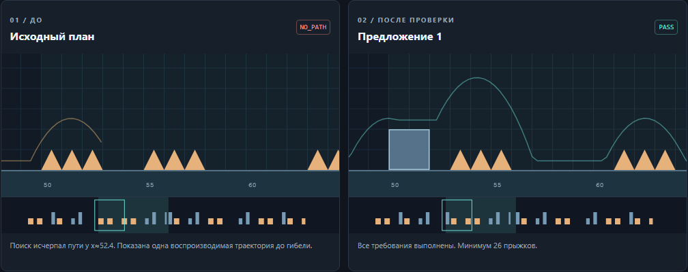
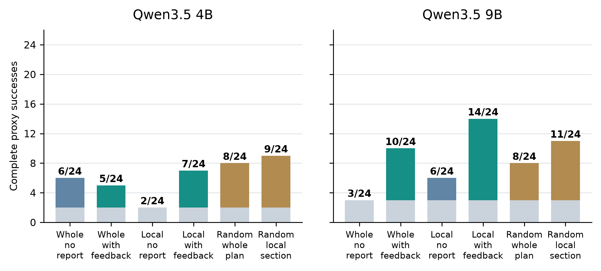

# DashLab

**Generate, verify, repair, and export Geometry Dash level prototypes with local Qwen models.**

Course project for *Modern Methods of Generative AI*. A model chooses obstacle patterns; a fixed compiler builds the geometry; an external search and rule checker evaluate it. Failed levels can receive up to three repair proposals. A shared acceptance guard retains confirmed progress.



The repository contains a working browser application, a recorded interactive demo, native level exports, and the complete final experiment. It includes **288 chains and 527 actual model responses**, including unsuccessful cases. Model weights and the game are separate installations.

## Start with the recorded demo

Requires **Node.js 22 or newer**. No npm runtime packages, Ollama, GPU, or internet connection are needed for playback.

```bash
git clone https://github.com/spirigon/dashlab.git
cd dashlab
npm run demo
```

Open **http://127.0.0.1:4174**. Select **M03** to inspect a failed plan, the literal one-section replacement, and both trajectories. Select **M04** to inspect a rejected proposal that loses requirements before a later successful repair. Downloads are available inside the demo. These examples were selected after outcomes to illustrate the mechanism; they are not an independent evaluation sample.

## Reproduce the recorded experiment

```bash
npm ci
npm run check
npm test
npm run reproduce
```

The replay reconstructs all 288 chains from the **frozen source versions and captured responses**, verifies prompts and request options, and checks that the recomputed analysis and metrics match the recorded result. It makes **zero model requests** and writes to a fresh directory under `artifacts/`; the committed dataset is read-only input. Runtime depends on the CPU; the replay performs the original searches rather than merely reading the aggregate table.

See [reproducibility](docs/reproducibility.md) for exact commands, expected outputs, figure generation, fresh inference, and determinism limits.

## Run the application with a local model

Install [Ollama](https://ollama.com/download), then:

```bash
ollama pull qwen3.5:4b
```

Copy `.env.example` to `.env` (`cp .env.example .env` on Unix, `Copy-Item .env.example .env` in PowerShell), then run:

```bash
npm start
```

Open **http://127.0.0.1:4173**. If Ollama is not running, start it with `ollama serve`. The application can preview, validate, replay, and export levels. Its interactive and optional elevated/coin modes are broader than the final measured study. The **six-condition retained-plan experiment is a separate CLI workflow**, not the main Generate button.

For new inference with the exact study implementation, install both recorded model profiles and follow [the experiment instructions](docs/experiments.md). A seed and matching settings do not guarantee identical outputs across hardware or Ollama versions.

## Main results

Twelve numeric briefs in six known families, two seeds each, two model profiles, and six repair conditions: **12 × 2 × 2 × 6 = 288 chains**. Every condition shares the initial Qwen plan within its model/case. Each cell below is complete proxy success out of 24: a full path **and all original requirements**.

| Repair condition | Qwen3.5 4B | Qwen3.5 9B |
|---|---:|---:|
| Whole plan, no diagnostic text | 6/24 | 3/24 |
| Whole plan, measured feedback | 5/24 | 10/24 |
| One section, no diagnostic text | 2/24 | 6/24 |
| One section, measured feedback | 7/24 | 14/24 |
| Random whole-plan repair | 8/24 | 8/24 |
| Random one-section repair | 9/24 | 11/24 |

For 9B, local feedback recovered **11/21 initially failing cases**, versus **3/21** without diagnostic text and **8/21** with random local repair. The primary 4B comparison remained inconclusive (`brief-cluster p = 0.125`). The 9B feedback/no-text result is secondary and exploratory. **Superiority over random repair is not established.** These are approximate-simulator results, not estimates of human difficulty or enjoyment.



Read [the method](docs/method.md), [the full experiment design](docs/experiments.md), and [the limitations](docs/limitations.md) before interpreting the table. The [English report](reports/DashLab_Report_EN.pdf) and [English defense slides](reports/DashLab_Defense_EN.pdf) provide the presentation version.

## Repository map

| Path | Contents |
|---|---|
| `src/` | Ollama client, compilers, repair controllers, acceptance guard, export, local application server |
| `public/` | English browser UI, simulation/search engines, recorded demo, local assets |
| `scripts/` | Documented commands for demo, data verification, replay, inference, plotting, and export |
| `test/` | Maintained core and application tests with local model stubs; no real inference |
| `examples/recorded-repairs/` | M01–M04 native exports, geometry, and original chain traces |
| `examples/` | Study briefs and regression fixtures for application features |
| `results/retained-plans-2026-10-24/` | Complete final dataset, model bindings, and 21 frozen source files |
| `results/MANIFEST.json` | SHA-256 and size for every committed evidence file |
| `docs/` | Architecture, method, experiment protocol, reproduction, and game import |
| `reports/` | One English report and one English slide deck; no duplicate builds |
| `artifacts/` | Ignored working outputs from replay, plots, exports, and new experiments |

All maintained documentation is English. Captured requests, original validator messages, fixtures, and frozen sources retain their original text, including Russian, to preserve provenance and exact replay. Earlier development datasets and presentation work files are intentionally excluded.

## Documentation

- [Architecture and data flow](docs/architecture.md)
- [Level representation, feedback, search, and guard](docs/method.md)
- [Experimental design, model bindings, and statistics](docs/experiments.md)
- [Offline replay and new inference](docs/reproducibility.md)
- [Native Geometry Dash import](docs/import.md)
- [Limitations and native-game evidence](docs/limitations.md)
- [Contributing](CONTRIBUTING.md)

Independent course research prototype; not affiliated with Geometry Dash or its developer. The final study uses ready-made model weights, without fine-tuning or reinforcement learning.

