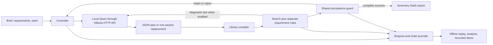

# Architecture

DashLab has two entry points: an interactive local application and a fixed research runner. Both use local model inference and independent programmatic checks. The recorded demo uses saved outputs only.

## Responsibilities

| Component | Implementation | Responsibility |
|---|---|---|
| Local application | `src/server.js`, `public/app.js` | Browser UI, model requests, preview, export, optional playtest recording |
| Ollama adapter | `src/llm.js` | HTTP requests, structured output, seeds, timeouts, recorded usage |
| Pattern compiler | `src/section-plan-generator.js`, `src/sectioned-study.js` | Turn named patterns into literal geometry |
| Retained-plan controller | `src/retained-plans.js` | Shared initial plan, target selection, local/whole proposals, stop conditions |
| Guard | `src/incremental-repair.js` | Retain acceptable candidates and preserve the previous plan after rejection |
| Physics and search | `public/engine.js` | Fixed-step cube simulation, path search, minimum jumps, numeric rules |
| Native export | `src/gd-export.js` | `.gdlvl` and `.gmd` serialization and structural inspection |
| Recorded demo | `public/repair-demo.*`, `scripts/demo.mjs` | Read-only playback of actual stored proposals |
| Study entry point | `scripts/study.mjs` | Launch the exact captured runner into an ignored new output directory |
| Reproduction entry point | `scripts/reproduce.mjs` | Replay the captured study and compare the full analysis and metrics |

The study wrapper runs the captured implementation under `results/retained-plans-2026-10-24/sources/`. Those 21 files preserve the original study semantics and hashes. The top-level `src/` also supports interactive and optional prototype features; it is not the authority used to reconstruct historical outcomes.

## Data flow

The model returns a four-section JSON plan or the replacement content of one section. The compiler determines exact object coordinates; it does not silently remove obstacles or substitute a known good level. The verifier returns geometry validity, reachability, rule outcomes, and a path when one exists. The guard accepts the candidate or retains the preceding state. Further proposals use the retained state. Complete success ends the chain.

The runner records unsuccessful candidates and rejected proposals, not just final successful maps. Exact identical initial requests are reused across conditions and explicitly journalled. `calls.jsonl` counts actual inference requests; `runs.jsonl` records all assigned chains. Offline replay reconstructs those chains with captured responses instead of calling a model.

Codex assisted implementation, testing, and preparation of presentation materials. The experimental level generator and model repair proposer were the recorded local Qwen profiles; Codex responses are not counted as experimental generations.

## Optional application features

Elevated blocks, ceiling spikes, coins, route separation, and timing windows are available as application prototypes. Their engines and regression fixtures remain in the repository. They are **not additional mechanics or endpoints in the final 288-chain study**. Earlier study runners and result batches are omitted from this curated repository.

